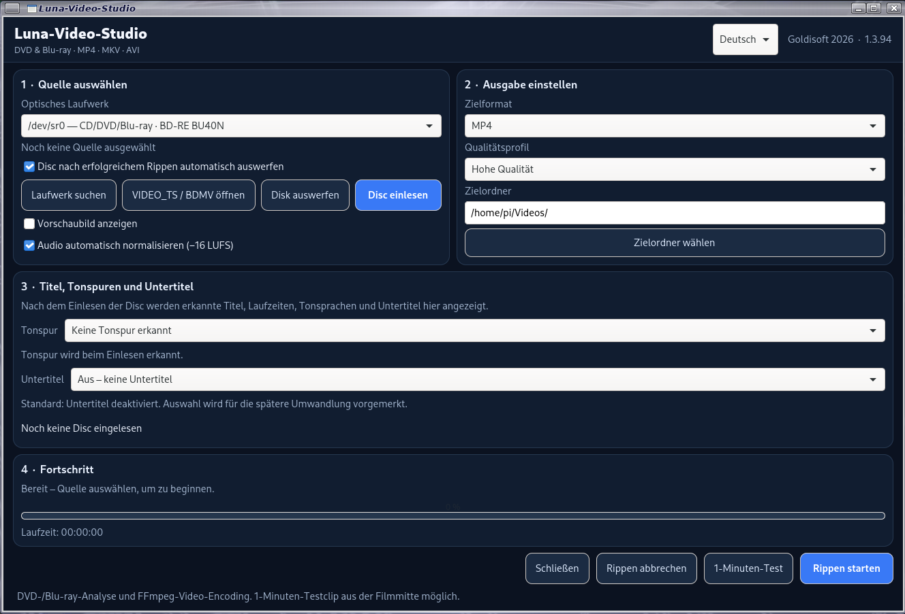

# LunaVideoStudio 1.3.94

GTK4-Anwendung für Debian/Linux und Raspberry PI OS zum Analysieren und Umwandeln von DVD- und Blu-ray-Titeln in MP4 MKV AVI. Die Videoverarbeitung erfolgt mit FFmpeg.



[Github Seite](https://github.com/Angonikro/LunaVideoStudio/)

**Rechtmäßige Nutzung:** 
LunaVideoStudio dient zum Analysieren und Umwandeln von Videomaterial, auf das du rechtmäßig zugreifen darfst. Verwende das Programm nur im Einklang mit den geltenden Gesetzen und den Rechten der Rechteinhaber. Die Anwendung stellt selbst keine Entschlüsselungsschlüssel oder Kopierschutz-Umgehungsfunktionen bereit und ist nicht dafür bestimmt, technische Schutzmaßnahmen zu umgehen.

## Funktionen

- Laufzeitanzeige während des Rippens und Anzeige der Gesamtdauer nach Abschluss (auch bei Abbruch/Fehler).
- Optische Laufwerke erkennen und DVD-/Blu-ray-Medien einlesen
- DVD-/Blu-ray-Titel sowie Audio- und Untertitelspuren anzeigen, soweit die Disc und installierten Werkzeuge diese Informationen bereitstellen
- Ausgabeformate MP4, MKV und AVI auswählen
- Qualitätsprofile für die Videoencodierung
- 1-Minuten-Testclip aus der Filmmitte erstellen
- Ausgewählte Untertitel werden je nach Ausgabeformat passend behandelt: MP4 verwendet den bestehenden MP4-Pfad, MKV übernimmt Untertitel als auswählbare Spur und AVI brennt ausgewählte DVD- und Blu-ray-Untertitel direkt ins Videobild ein, damit sie beim Abspielen sichtbar sind; sie sind danach nicht abschaltbar.
- Disc per Schaltfläche manuell auswerfen
- Option zum automatischen Auswerfen nach erfolgreichem Rippen oder erfolgreichem 1-Minuten-Test direkt im Bereich „Quelle auswählen“

## Optionen im Bereich „Quelle auswählen“

Die Optionen **„Vorschaubild anzeigen“** und **„Audio automatisch normalisieren (−16 LUFS)“** befinden sich jetzt ebenfalls im Bereich „Quelle auswählen“. Beide Beschriftungen sind auf Deutsch und Englisch verfügbar. Ihre Zustände werden in `~/.config/luna-video-studio/settings.json` gespeichert.

## Automatisches Auswerfen

Im Bereich **„Quelle auswählen“** befindet sich die Checkbox **„Disc nach erfolgreichem Rippen automatisch auswerfen“**.

- Standardmäßig ist die Option ausgeschaltet.
- Wenn aktiviert, wird das optische Laufwerk nach einem erfolgreich abgeschlossenen vollständigen Rippen zum Auswerfen angewiesen.
- Bei einem fehlgeschlagenen oder abgebrochenen Vorgang bleibt die Disc eingelegt.
- Wenn die Option aktiviert ist, wird die Disc auch nach einem erfolgreich erstellten 1-Minuten-Testclip ausgeworfen.
- Wenn ein VIDEO_TS-/BDMV-Ordner statt eines optischen Laufwerks als Quelle gewählt wurde, wird keine Disc ausgeworfen.
- Zum Auswerfen wird das Systemprogramm `eject` benötigt.

## Languages / Sprachen

The interface supports German and English. Choose **Deutsch** or **English** in the language selector in the header; the selection is saved in `~/.config/luna-video-studio/settings.json`.

Die Oberfläche unterstützt Deutsch und Englisch. Die Sprache lässt sich oben im Fenster auswählen und wird in `~/.config/luna-video-studio/settings.json` gespeichert.

## Blu-ray-Untertitel in MP4

Blu-ray-Untertitel sind häufig PGS-Bildspuren. MP4 kann diese nicht als normale auswählbare Textspur übernehmen. Bei ausgewählter Blu-ray-PGS-Untertitelspur werden Untertitel bei MP4 weiterhin ins Videobild eingebrannt. Bei MKV bleiben PGS-Untertitel als separate auswählbare Spur erhalten. Bei AVI werden ausgewählte DVD- und Blu-ray-Untertitel direkt ins Bild eingebrannt. Sie sind dadurch mit üblichen AVI-Playern sichtbar, können aber nach dem Rippen nicht mehr abgeschaltet werden. Das gewählte Ausgabeformat wird auch beim 1-Minuten-Test verwendet. Ohne ausgewählte Untertitel wird kein Untertitel eingebrannt.

## Vorschaubild und gespeicherte Einstellungen

Die Checkbox **„Vorschaubild anzeigen“** öffnet ein separates Vorschaufenster mit 1024 × 768 Pixeln. Nach dem Einlesen der Disc wird darin ein Standbild aus der Mitte des ausgewählten Titels angezeigt. Das gewählte Qualitätsprofil wird bei der Erzeugung der Vorschau berücksichtigt. Bei erneutem Aktivieren der Checkbox öffnet sich das Fenster wieder.

Die Einstellungen werden automatisch in `~/.config/luna-video-studio/settings.json` gespeichert: Sprache, alle Checkboxen, Zielordner, Zielformat und Qualitätsprofil.

## 1-Minuten-Test

1. DVD oder Blu-ray einlegen und im Bereich „Quelle auswählen“ auf **Disc einlesen** klicken.
2. Gewünschte Ton- und Untertitelspur auswählen.
3. Ausgabeordner und Zielformat wählen.
4. Auf **1-Minuten-Test** klicken.
5. Die erzeugte Datei mit dem Suffix `_TEST_1_MINUTE.mp4` prüfen.

Wenn die automatische Auswurffunktion aktiviert ist, wird die Disc auch nach einem erfolgreich erstellten 1-Minuten-Testclip ausgeworfen. Bei einem Abbruch wird sie nicht ausgeworfen.

## Hintergrund: DVD-Titelauswah

## Zielordner pro Disc

Der eingestellte Zielordner ist der Basisordner (zum Beispiel `~/Videos`). Nach erfolgreichem Einlesen wird im Feld automatisch ein Unterordner mit dem erkannten Disc-/Filmnamen angezeigt, zum Beispiel `~/Videos/test1`. In `~/.config/luna-video-studio/settings.json` bleibt nur der Basisordner gespeichert. Beim Einlesen der nächsten Disc wird der neue Titelordner relativ zum gleichen Basisordner angezeigt.

## Installation: Debian-Paket

Installiere LunaVideoStudio:

```bash
sudo apt install ./LunaVideoStudio_1.3.94_all.deb
```

Starte die Anwendung über das Anwendungsmenü oder im Terminal mit:

```bash
luna-video-studio
```

## ZIP-/GitHub-Version starten

Entpacke `LunaVideoStudio_1.3.94_GITHUB.zip`. Im Archiv liegt der Projektordner `LunaVideoStudio`. Öffne ein Terminal in diesem Ordner und installiere die Abhängigkeiten:

Für die Anwendung, DVD-/Blu-ray-Analyse und das Encoding werden diese Systempakete benötigt:

### Systempakete

```bash
sudo apt update
sudo apt install python3 python3-gi gir1.2-gtk-4.0 ffmpeg mediainfo lsdvd eject libbluray2 libaacs0 libbdplus0 libdvdnav4 libdvdread8t64
```

Starte die Anwendung aus dem Projektordner:

```bash
python3 src/luna_video_studio/main.py
```

Optional kann der mitgelieferte Starter verwendet werden:

```bash
chmod +x packaging/luna-video-studio
./packaging/luna-video-studio
```
## Abhängigkeiten und optionale Untertitelwerkzeuge

```bash
sudo apt update
sudo apt install pipx mkvtoolnix
```
`mkvtoolnix` stellt unter anderem `mkvmerge` bereit und wird für zusätzliche MKV-Werkzeuge benötigt.

### Blu-ray-PGS-Untertitel mit OCR

Für das Auslesen/OCR von Blu-ray-PGS-Bilduntertiteln kann zusätzlich `pgsrip` mit RapidOCR in einer isolierten pipx-Umgebung installiert werden:

```bash
pipx install "pgsrip[rapidocr]"
```

Falls `pipx` nach der Installation meldet, dass die ausführbaren Programme nicht im Suchpfad liegen, führe aus:

```bash
pipx ensurepath
```

Danach gegebenenfalls ab- und wieder anmelden. `pgsrip` ist ein zusätzliches Werkzeug für die Untertitelverarbeitung; die normale FFmpeg-Verarbeitung und das Einbrennen ausgewählter PGS-Spuren bei MP4/AVI benötigen weiterhin FFmpeg.

## Hinweise zur Fehlersuche

- Prüfe, ob im Untertitel-Dropdown tatsächlich eine Sprache und nicht „Aus – keine Untertitel“ ausgewählt ist.
- Bei Fehlern notiere den letzten Fehlertext aus dem Statusbereich.
- Die Anwendung wurde in dieser Arbeitsumgebung nicht an einem physischen DVD-/Blu-ray-Laufwerk getestet. Bitte die neue Auswurffunktion zunächst mit einer entbehrlichen Disc testen.

## Projektstruktur

- `src/luna_video_studio/main.py` – Anwendung
- `packaging/` – Debian-Paket-Metadaten, Starter und Desktop-Datei
- `CHANGELOG.md` – Versionsänderungen

73 de DO2QG Andreas
